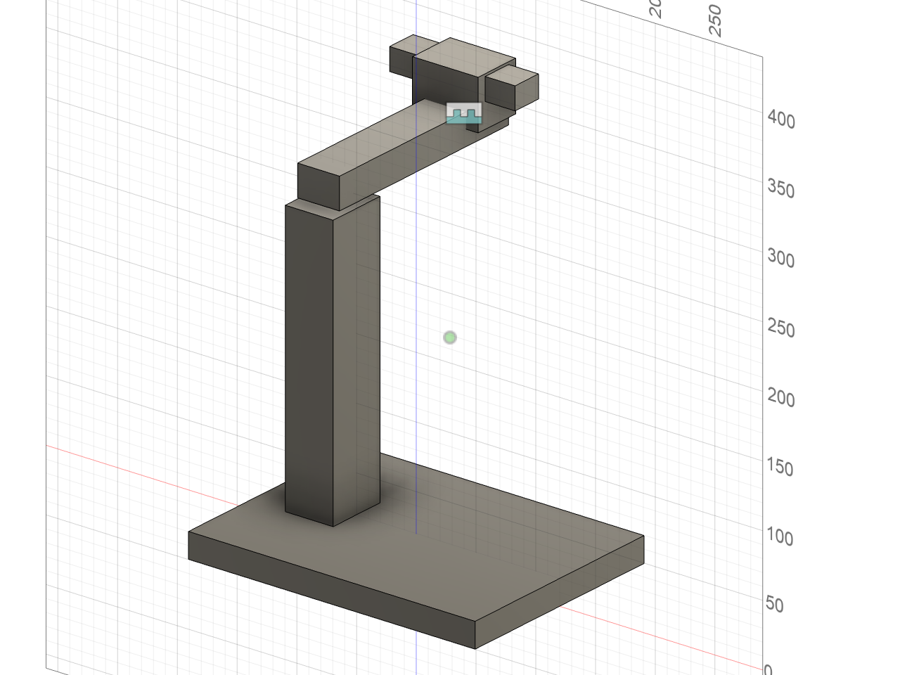
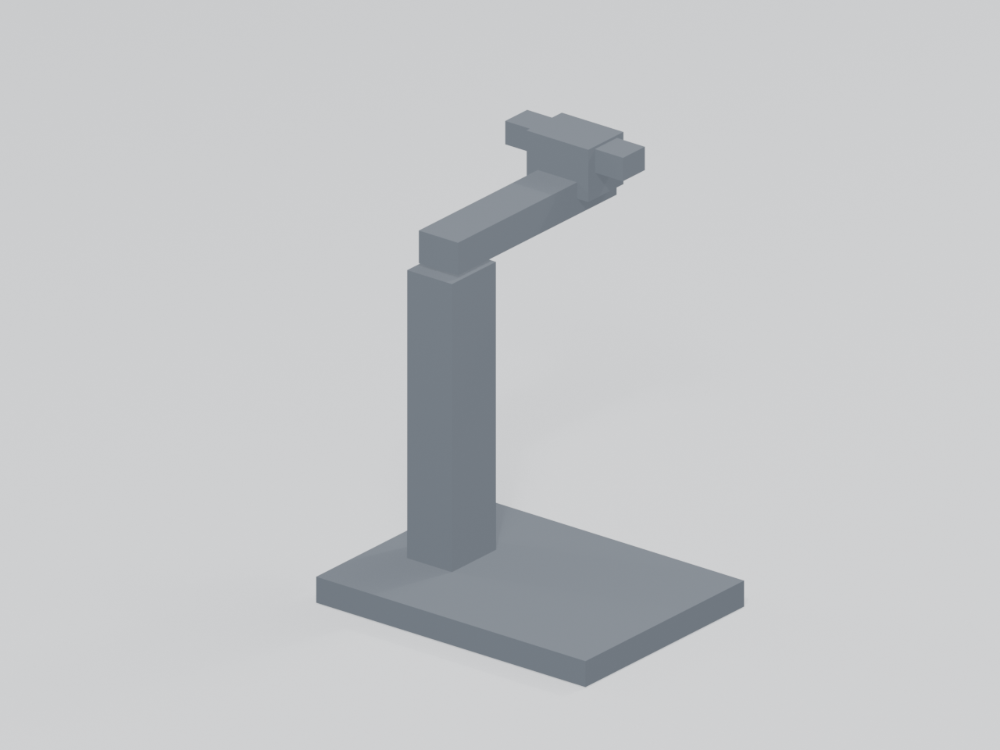
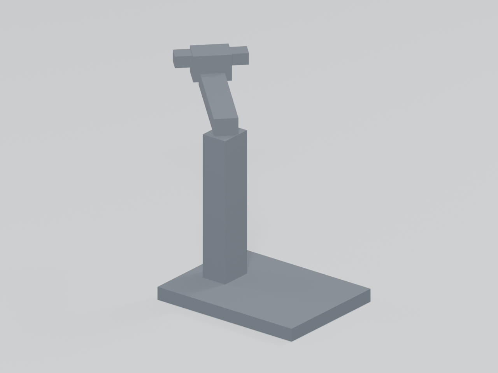
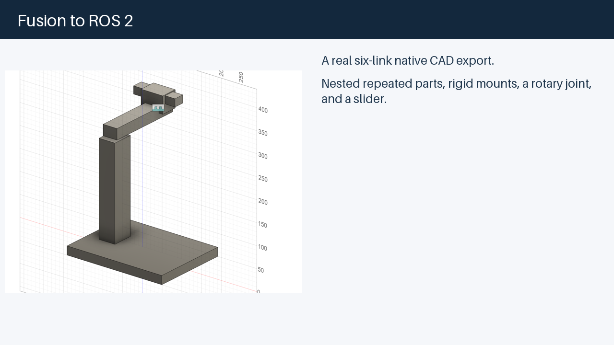
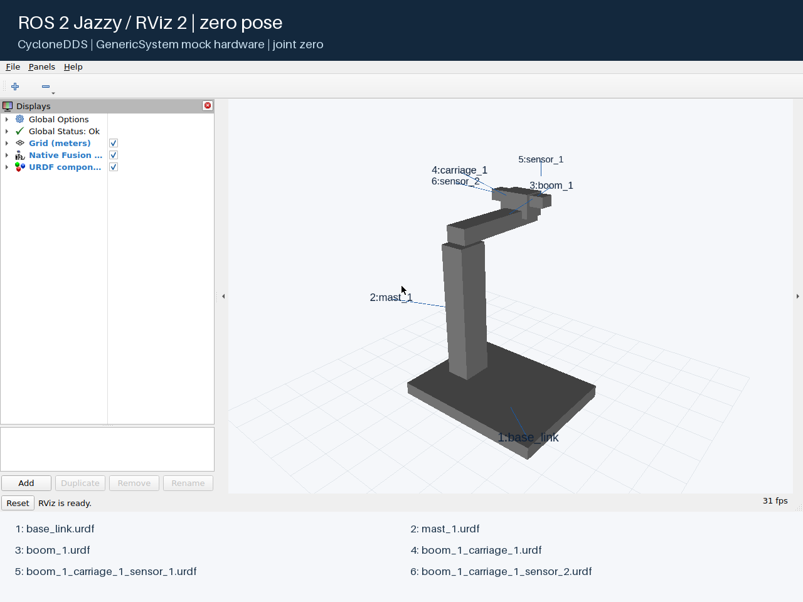
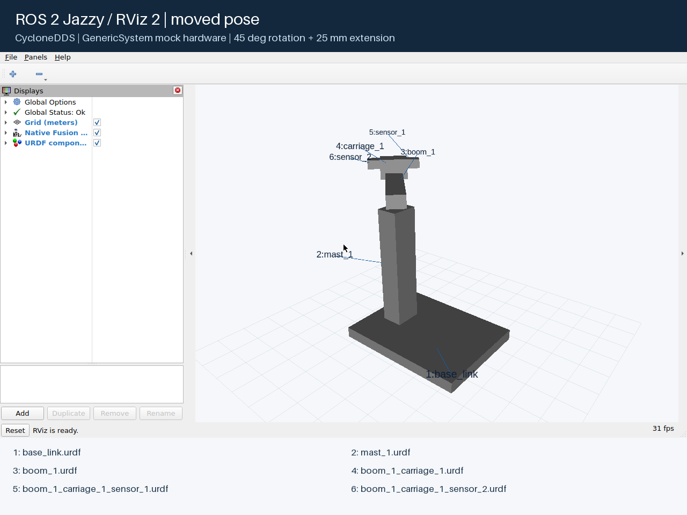

# fusion360tourdf

[](https://github.com/kyeshmz/fusion360tourdf/actions/workflows/verify.yml)
[](#requirements)
[](docs/verification-results.md)
[](#use-the-package-in-ros-2)
[](LICENSES.md)

Export Autodesk Fusion assemblies to ROS 2: meshes, joints, mass, inertia, and ready-to-build robot description packages. Get a complete robot URDF **and a separate URDF for every link**, with RViz viewers and optional mock joint control.

The dependency-free exporter runs **inside Fusion** and preserves the source design's editable history. Terminal installers place its files; they do not perform headless CAD export. Generated packages target **ROS 2 Humble and Jazzy**.

This is an integration fork of [syuntoku14/fusion2urdf](https://github.com/syuntoku14/fusion2urdf), not a from-scratch exporter. [Source credits and licenses](LICENSES.md) and the [combined-version changelog](changelog.md) distinguish inherited code, adapted ideas, comparison references, and work developed here.

[Quick start](#quick-start) · [Requirements](#requirements) · [Component files](#ready-to-use-demo-urdfs) · [CLI](#command-line-integration) · [ROS 2](#use-the-package-in-ros-2) · [Limits](#supported-inputs-and-limits) · [Contributing](CONTRIBUTING.md)

## Quick start

Install host **Python 3.11+**, then clone the repository or download and extract its ZIP:

```bash
git clone https://github.com/kyeshmz/fusion360tourdf.git
cd fusion360tourdf
```

Run the one-line installer for your platform:

| macOS terminal | Windows PowerShell or Command Prompt |
| --- | --- |
| `bash install.sh` | `.\install.cmd` |

1. In Fusion, keep **Capture Design History enabled**. Use connected solid components with materials and joint limits; choose `base_link` or configure the root.
2. Open **Utilities > Add-ins > Scripts and Add-ins > Scripts**, select **URDF_Exporter**, and choose **Run**. If it is absent, add the installed folder printed by the installer.
3. Choose a fresh output parent. Copy the generated `your_robot_description` package to your ROS workspace's `src` folder and [build/launch it](#use-the-package-in-ros-2).

Nothing is exported by the installer, and existing robot packages are never overwritten. To inspect installation first, append `--dry-run`. To update a changed installation, close Fusion and use `--update`; local configuration and a backup are retained. [Custom paths, recovery, and manual installation](docs/installation.md).

## Example: Fusion to URDF

The six-link rotary-slide demo includes a grounded mast, a revolute joint, a nested slider, and two instances of one sensor component.

| Native Fusion assembly | Exported URDF: zero pose | Exported URDF: moved pose |
| --- | --- | --- |
|  |  |  |

The Blender pictures use the actual exported meshes with neutral preview shading. The moved pose rotates 45 degrees and extends 25 mm; it does not simulate physics. [Reproduce the model and pictures](docs/demo-workflow.md).

## Walkthrough and real ROS views

[](docs/media/walkthrough.mp4)

[Download the walkthrough (MP4)](docs/media/walkthrough.mp4) or read the [chapter transcript](docs/media/walkthrough.md). The movie combines illustrated installation/export instructions with actual RViz joint-motion footage; it is not a continuous recording of Fusion menu clicks and has no audio narration.

| Real ROS 2 Jazzy / RViz 2: zero pose | Real ROS 2 Jazzy / RViz 2: commanded pose |
| --- | --- |
|  |  |

These views use the installed native package and verified mock-controller feedback, not Blender previews. Numbered text/leader lines are presentation markers attached to the corresponding URDF frames; the filename legends match the component catalog. This is mock hardware, not physical-hardware or dynamics evidence.


The [showcase guide](docs/showcase.md) explains how to capture and rebuild the labeled media from a fresh native export.

## What you get

Each export creates a self-contained ROS 2 description package:

- Complete `.urdf` and self-contained `.xacro`, plus one-link component URDFs sharing the package meshes.
- Binary STL visual/collision geometry, SI-unit mass/inertia, joint frames, axes, and limits.
- Nested and repeated instances with distinct identities; supported fixed, rotary, and slider connections.
- Display/RViz assets under `viewers/`; mock ros2_control launch/configuration for movable robots.
- Transactional publication and a topology/warning sidecar, without changing the source assembly.

```text
your_robot_description/
├── package.xml
├── CMakeLists.txt
├── urdf/your_robot.xacro
├── urdf/your_robot.urdf
├── urdf/components/*.urdf
├── meshes/*.stl
├── viewers/
│   ├── display.launch.py
│   └── display.rviz
├── launch/control.launch.py
└── config/
    ├── controllers.yaml
    └── robot_data.yaml
```

Movable robots include the control launch file and controller configuration. Fixed-only robots omit those assets. `robot_data.yaml` records the topology, warnings, and any removed loop-closing constraints; its JSON formatting is valid YAML.

The plain `.urdf` describes the complete robot. Each component file contains one link with the same visual, collision, and inertial data, but no joints or controllers. Component files reuse the package’s meshes; copy or install the complete package, not an isolated XML file.

### Ready-to-use demo URDFs

The [native example package](Example/rotary_slide_description/) includes the full assembly and every labeled component. Download or clone the complete package so its mesh resources remain available:

| Label | Component | URDF file |
| --- | --- | --- |
| All | Complete assembly | [rotary_slide.urdf](Example/rotary_slide_description/urdf/rotary_slide.urdf) |
| 1 | Base | [base_link.urdf](Example/rotary_slide_description/urdf/components/base_link.urdf) |
| 2 | Mast | [mast_1.urdf](Example/rotary_slide_description/urdf/components/mast_1.urdf) |
| 3 | Rail | [boom_1.urdf](Example/rotary_slide_description/urdf/components/boom_1.urdf) |
| 4 | Carriage | [boom_1_carriage_1.urdf](Example/rotary_slide_description/urdf/components/boom_1_carriage_1.urdf) |
| 5 | Sensor 1 | [boom_1_carriage_1_sensor_1.urdf](Example/rotary_slide_description/urdf/components/boom_1_carriage_1_sensor_1.urdf) |
| 6 | Sensor 2 | [boom_1_carriage_1_sensor_2.urdf](Example/rotary_slide_description/urdf/components/boom_1_carriage_1_sensor_2.urdf) |

See the [example notes](Example/rotary_slide_README.md) for shared meshes and local-frame semantics. The package was regenerated after pulling the installer/viewer contribution; it retains the separate `viewers/` layout.

### Archive the package or viewers

The display launcher and RViz configuration live together in `viewers/`.
Control files stay under `launch/` and `config/`. The exporter does not copy
Blender or validation helpers into the robot package.

This layout applies to new exports. Re-export an older model into a fresh
directory. Moving old files alone does not update their launch and CMake paths.

From the export's parent directory, create either archive with Python's
standard ZIP command:

```bash
python3 -m zipfile -c my_robot_description.zip my_robot_description
python3 -m zipfile -c my_robot_viewers.zip my_robot_description/viewers
```

The first archive contains the complete buildable ROS package. The second
contains only `viewers/`. It requires the matching description package's URDF,
meshes, and package metadata. Extract the viewer folder into that package.
Keep the full directory layout when building the complete package.
The launch command remains `ros2 launch my_robot_description display.launch.py`.

## Requirements

Python on your terminal, Python embedded in Fusion, and Python supplied by ROS are **different runtimes**. Installing a newer host Python does not upgrade Fusion.

| Workflow | Required / supported | Evidence and boundaries |
| --- | --- | --- |
| Install, build the single-file CLI, run offline tests | Host CPython **3.11+** on `PATH` | CI matrix: **3.11, 3.12, 3.13, 3.14**; configured coverage is not a claim that each hosted job has passed |
| Export CAD | Autodesk Fusion **May 2025+**, macOS or Windows; embedded Python **3.11+** for TOML | Native checks: Fusion **2705.1.30**, embedded Python **3.14.0**, on macOS; not every Fusion build is verified |
| Display and command the exported package | ROS 2 **Humble / Ubuntu 22.04** or **Jazzy / Ubuntu 24.04** | Installed-package and mock-controller checks on both; ROS uses its own Python (Humble's Python 3.10 is not the host-tool requirement) |
| Reproduce full verification | Fusion, optional [test requirements](requirements-test.txt), Blender, and Docker Engine | External tools, not exporter dependencies; see [CONTRIBUTING.md](CONTRIBUTING.md) |
| Rebuild movie / labeled ROS pictures | Optional [media requirement](requirements-media.txt), FFmpeg/ffprobe, GUI-enabled Docker image | See [showcase instructions](docs/showcase.md) |

Fusion is not natively supported on Linux; Linux can consume the ROS packages and run verification. Custom installer paths do not certify Fusion under Wine. Windows launcher tests are configured in CI; local macOS results are not native Windows evidence.

ROS and Blender are not required to export. Fusion and ROS can run on different computers. The README previews used Blender **5.2.2 LTS**. The tools do not download Python or require administrator privileges for default user-local installation.

## Install and export

The [quick start](#quick-start) installs the complete exporter into Fusion's default Scripts folder:

| Platform | Default Scripts folder |
| --- | --- |
| Windows | `%APPDATA%\Autodesk\Autodesk Fusion 360\API\Scripts` |
| macOS | `~/Library/Application Support/Autodesk/Autodesk Fusion 360/API/Scripts` |

Both launchers accept the same flags:

```bash
bash install.sh --scripts-dir "/custom/Fusion/API/Scripts" --dry-run
bash install.sh --update
```

Use `.\install.cmd` with the same arguments on Windows. `--scripts-dir` names the **Scripts parent**, not its `URDF_Exporter` subfolder; use it again on updates if you used it initially.

The installer preserves `xacro_export.toml` byte-for-byte and retains the old installation outside Scripts under `.fusion360tourdf-backups/`. It leaves the checkout intact and never starts Fusion or changes its folder preferences. Restart Fusion after updates so cached modules are not reused. See [detailed installation and recovery](docs/installation.md).

### Command-line integration

Need to pass installation around as one executable file instead of a checkout? Build the standard-library Python zipapp:

```bash
python3 tools/build_installer.py --output artifacts/fusion360tourdf-install.pyz
python3 artifacts/fusion360tourdf-install.pyz --help
python3 artifacts/fusion360tourdf-install.pyz --dry-run
```

The `.pyz` bundles the exporter, configuration template, and license notices. It runs without the original checkout and delegates all install/update rules to the same Python helper. On macOS/Linux it is also executable as `./artifacts/fusion360tourdf-install.pyz`; on Windows use `py -3 artifacts\fusion360tourdf-install.pyz` with a 3.11+ runtime selected.

**This is not a native `.exe` or a bundled Python runtime:** recipients still need Python 3.11+. We do not ship a standalone CAD converter or support an `export model.f3d` shell command. Native binaries would not remove the Fusion requirement. [CLI options, exit codes, trust, and automation boundaries](docs/cli.md).

### Prepare the model

Check these conditions before exporting:

- Make each independently moving link a component occurrence; a link can contain multiple solid bodies.
- Name the chassis `base_link`, or configure an exact `root_occurrence` path.
- Connect every selected link with rigid, revolute, or slider joints, fixed groups, or supported grounding relationships.
- Set both bounds for a bounded joint. Sliders require finite lower and upper travel limits.
- Assign physical materials and check mass properties in Fusion.
- Use visibility to select geometry, but suppress a joint only when you intend to remove its constraint.

**Keep Capture Design History enabled.** Export reads the active design’s root assembly, not only the activated component. It must not reset joints, rename components, move bodies, or remove history. Leave the assembly unchanged while export runs.

Existing output is never overwritten. The exporter stages files and publishes the package only after mesh validation succeeds; canceling the folder dialog creates no package. The first word of the design/root name determines the package name: `My Robot` produces `my_description`.

See the [model requirements](DESIGN_RULES.md) and [assembly/export guide](docs/exporting.md) for nested components, root selection, frames, visibility, and history-related errors.

## Use the package in ROS 2

Copy the generated description package into your ROS workspace’s `src` directory. In a sourced ROS environment, install dependencies, build the workspace, and launch the display:

```bash
source /opt/ros/jazzy/setup.bash
cd your_ros2_workspace
rosdep install --from-paths src --ignore-src -r -y
colcon build
source install/setup.bash
ros2 launch your_robot_description display.launch.py
```

For Humble, source `/opt/ros/humble/setup.bash` instead. Replace `your_robot_description` with the generated package name.

Use the copy install shown above for a self-contained install space.
`--symlink-install` leaves meshes dependent on the source workspace. The strict
portable-mesh checks, including the native-package old-root guard, reject
external source-workspace targets. The symlink-install probes did not reach
controller verification and are not passing full-runtime evidence.

The display launch starts RViz and the joint-state GUI. To run without either GUI:

```bash
ros2 launch your_robot_description display.launch.py gui:=false rviz:=false
```

For a movable robot, start the mock joint-state broadcaster and trajectory controller:

```bash
ros2 launch your_robot_description control.launch.py
```

Do not run a separate joint-state publisher against the same joints during mock control. Mock hardware tests commands and state propagation, not forces, collisions, dynamics, or physical hardware. The Docker tests use CycloneDDS; generated packages do not select a middleware implementation.

## Configure the export

In the installed `URDF_Exporter` directory printed by the installer, copy
`xacro_export.template.toml` to `xacro_export.toml` beside the entry script.
If Fusion runs the checkout directly, create that file in the checkout instead.
Use TOML values with their actual types:

```toml
mesh_refinement = "low"
collision_method = "visual"
effort = 100.0
velocity = 100.0
root_occurrence = ""
```

| Option | Values or meaning |
| --- | --- |
| `mesh_refinement` | `low`, `medium`, or `high` STL tessellation |
| `collision_method` | `visual` mesh collision, or `primitive_box` where bounds are available |
| `effort` | Positive finite limit in N·m for rotation or N for translation |
| `velocity` | Positive finite limit in rad/s or m/s, depending on joint type |
| `root_occurrence` | Automatic selection when empty; otherwise an exact occurrence path or `design_root` for root-owned bodies |

Unknown options and invalid values stop export. Obsolete ROS 1, legacy-copy, and transmission/control switches are not supported. See the [configuration and frame details](docs/exporting.md#configure-the-exporter).

## Reproduce the verified demo

Run the Fusion script in `tools/create_demo` to create the assembly pictured above. It exports a native `.f3d` archive, a ROS package, independent pose expectations, a source-preservation receipt, and a Fusion viewport PNG.

From the checkout root, install the separate verification requirements and test that actual native export:

```bash
python3 -m venv .venv
.venv/bin/python -m pip install -r requirements-test.txt
.venv/bin/python tools/verify_export.py /path/to/rotary-slide-bundle \
  --output artifacts
```

The runner checks mesh loading and forward kinematics, renders zero/moved previews in Blender, then builds and commands the supplied package in Docker on Humble and Jazzy. It does not generate a substitute robot fixture.

Follow the [demo workflow](docs/demo-workflow.md) for Fusion setup, commands, evidence files, and [README picture refresh instructions](docs/demo-workflow.md#refresh-the-readme-pictures).

## Verification

On October 19, 2026, the macOS integration run pulled `7bf5a13` and verified the combined component-URDF and `viewers/` changes. The labeled RViz captures and movie use that fresh native export:

| Check | Observed result |
| --- | --- |
| Offline regressions | 275 tests on CPython 3.11.11 and 3.13.2: 262 passed, 13 platform skips per run |
| Offline in Docker Jazzy / Python 3.12 | Same 275 tests: 263 passed, 12 platform skips |
| Single-file installer | Install, dry-run, safe update/backup, private-config exclusion, license inclusion, and POSIX execution passed |
| Native six-link demo | 449 CAD/export assertions passed |
| Component URDFs | All six loaded independently with their shared visual/collision meshes |
| Independent loader and Blender | Seven integration tests and three Blender variants passed; wrong-axis/shifted/missing-mesh controls rejected |
| ROS 2 Humble and Jazzy | Installed native assets matched hashes; controllers activated; trajectory, joint feedback, and six-link transforms passed |

An earlier eleven-case native fixture run covers its own source snapshot, not the entire merged tree. Native Windows execution and hosted Python 3.12/3.14 jobs require their own CI evidence. See [verification results](docs/verification-results.md) for source hashes, receipts, and limits: these checks do not establish universal CAD coverage, real hardware, or a head-to-head comparison with other exporters. Developer setup and test requirements are in [CONTRIBUTING.md](CONTRIBUTING.md).

## Supported inputs and limits

Use BRep solid assemblies with physical links and a connected mechanism. The maintained inputs include ordinary/as-built rigid, revolute, continuous, and slider joints; nested/repeated occurrences; root-owned bodies; and locked joints fixed at their current pose.

Rigid groups and representable grounding relationships become fixed connections. Ground To Parent support is partial: unresolved bodyless/world frames fail rather than receiving guessed attachments.

These input and fidelity gaps remain:

- Motion-link conversion into affine mimic relations
- Mesh-only input with a validated mass/inertia and export policy
- General bodyless assembly or reference-frame endpoints
- Active cylindrical, planar, pin-slot, and ball joint decomposition
- Distinct materials or textures per body or face in combined STL output

URDF describes a tree. A loop-closure sidecar records removed constraints but does not enforce closed-chain motion. ROS 1, SDF, MJCF, simulator backends, and other CAD systems are outside the maintained output scope.

Consult the [input-support matrix](docs/fusion-coverage.md) for case-level status and the [pinned repository audit](docs/related-work.md) for the source comparisons behind the test cases.

## Documentation

Choose the guide for your next task:

- [Model requirements](DESIGN_RULES.md): assembly, frames, and output invariants
- [Installation and recovery](docs/installation.md): paths, safe updates, manual fallback, and troubleshooting
- [CLI integration](docs/cli.md): single-file executable installer and automation boundaries
- [Assembly and export guide](docs/exporting.md): root selection, physical properties, configuration, and troubleshooting
- [Native demo workflow](docs/demo-workflow.md): create, verify, and photograph a real Fusion model
- [Testing guide](docs/testing.md): offline, loader, Blender, Docker, and native recipes
- [Verification results](docs/verification-results.md): executed evidence and remaining limits
- [Contributing](CONTRIBUTING.md): development setup, tests, and review requirements
- [Showcase capture](docs/showcase.md): real RViz pictures, motion, and the walkthrough build

`Example/Basic_Robot.f3d` is the inherited sample. Its adjacent ROS 1 package is historical output; re-export the design for ROS 2.

## License and attribution

MIT, retaining Toshinori Kitamura's original copyright. See [LICENSE](LICENSE), the [license index](LICENSES.md), and [bundled third-party notices](URDF_Exporter/THIRD_PARTY_NOTICES.md) for all nine pinned repositories and their retained copyright/license texts. Notices distinguish inherited code, adapted guidance, and comparison-only sources; listing a project does not imply its code was imported wholesale.

## Contribute or report a problem

Read [CONTRIBUTING.md](CONTRIBUTING.md) for developer setup and verification requirements. For a bug, [open an issue](https://github.com/kyeshmz/fusion360tourdf/issues/new) with your Fusion/OS versions, relevant TOML settings, exact error, and a minimal shareable model. Remove private CAD, account data, and credentials before attaching files. Please keep source-preservation and negative-control checks intact when proposing a fix.
