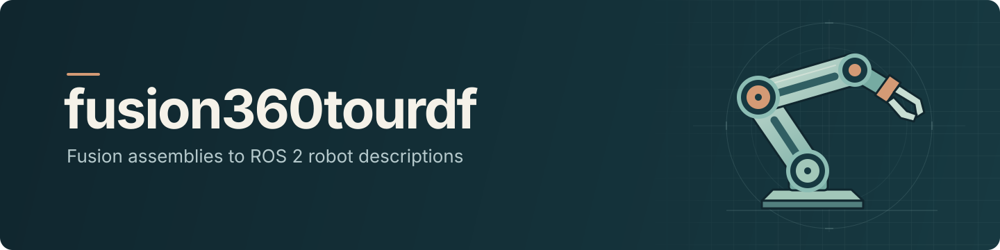
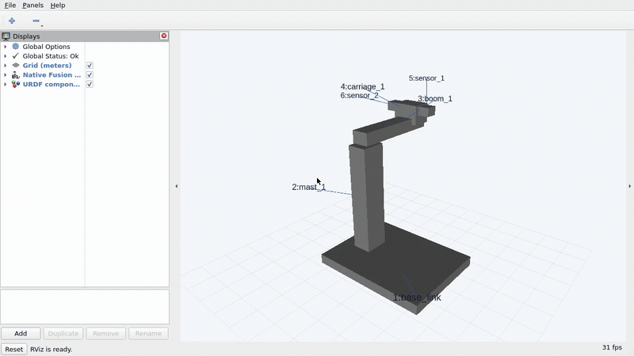

[](#requirements)
[](#use-the-package-in-ros-2)
[](LICENSES.md)

Export Autodesk Fusion assemblies to ROS 2 description packages with meshes, joints, mass, and inertia.
Each package includes a complete robot URDF and a separate URDF for every link, with RViz viewers and optional mock joint control.

The dependency-free exporter runs **inside Fusion** and preserves the source design's editable history.
Terminal installers place its files. They do not perform headless CAD export.

This is an integration fork of [syuntoku14/fusion2urdf](https://github.com/syuntoku14/fusion2urdf), not a from-scratch exporter.
This independent community fork is not affiliated with or endorsed by Autodesk.
See [source credits and licenses](LICENSES.md) and the [combined-version changelog](changelog.md).

[Install](#install) · [Export](#export-in-fusion) · [Demo files](#ready-to-use-demo) · [Verification](docs/verification.md) · [Contributing](CONTRIBUTING.md)

## Highlights

- Complete `.urdf` and self-contained `.xacro`, plus one-link component URDFs sharing the package meshes.
- Binary STL visual/collision geometry, SI-unit mass/inertia, joint frames, axes, and limits.
- Nested and repeated component instances with distinct identities and supported fixed, rotary, and slider connections.
- RViz display assets under `viewers/` and mock ros2_control launch/configuration for movable robots.
- Transactional publication into a fresh package, with topology/warning metadata and no source assembly changes.

## Motivation

Existing Fusion-to-URDF exporters provided a useful foundation, but their assembly handling did not consistently meet this project's needs.
The [source comparison](docs/related-work.md) documents gaps and tradeoffs in nested/repeated instances, joint frames, physical properties, and export safety.
Some documented workflows even recommended disabling design history as a workaround.

A successful export message and valid XML are not enough if parts overlap, a joint turns about the wrong axis, or mesh scale and inertia are wrong.
This fork aims to carry the assembly into ROS 2 correctly without sacrificing the editable CAD design or requiring manual URDF repairs.
That means preserving instance identities, geometry, joint travel, and physical data, and treating incomplete exports as failures rather than success.

We build on and credit the existing exporters instead of starting over.
The goal is a reliable Fusion-to-ROS 2 workflow with [explicit limits](#supported-inputs-and-limits), not a claim that every alternative is broken or every Fusion mechanism is supported.

## Requirements

| Task | Requirement |
| --- | --- |
| Install or build the installer | Host Python **3.11+** on `PATH` |
| Export CAD | Autodesk Fusion **May 2025+** on macOS or Windows, with embedded Python **3.11+** for TOML |
| Use the ROS package | ROS 2 **Humble / Ubuntu 22.04** or **Jazzy / Ubuntu 24.04** |

Host Python, Fusion's embedded Python, and ROS Python are separate runtimes.
Installing host Python does not upgrade Fusion. Humble's Python 3.10 does not change the host-tool requirement.
ROS and Blender are not needed to export. Fusion and ROS can run on different computers.
Fusion is not natively supported on Linux. Custom installer paths do not certify Fusion under Wine.
See the [verification overview](docs/verification.md) for tested environments, optional tools, and evidence limits.

## Install

Clone the repository, or download and extract its ZIP. From the checkout root, run the installer for your platform:

```bash
git clone https://github.com/kyeshmz/fusion360tourdf.git
cd fusion360tourdf
```

| Action | macOS terminal | Windows PowerShell or Command Prompt |
| --- | --- | --- |
| Install | `bash install.sh` | `.\install.cmd` |
| Inspect without changing the destination | `bash install.sh --dry-run` | `.\install.cmd --dry-run` |
| Update a changed installation | `bash install.sh --update` | `.\install.cmd --update` |

The default destination is Fusion's user-local Scripts folder. The installer does not request administrator access or download Python.
For a custom location, pass `--scripts-dir "/custom/Fusion/API/Scripts"` on macOS or `--scripts-dir "C:\Fusion Scripts"` on Windows.
The path names the **Scripts parent**, not its `URDF_Exporter` subfolder. Relative paths are relative to your terminal's current directory.
Use the same custom path again on updates.
Linux/Wine installations must supply `--scripts-dir`; the location is not guessed.

Close Fusion before updating. Updates preserve `xacro_export.toml` byte-for-byte and retain the old installation outside Scripts under `.fusion360tourdf-backups/`.
Restart Fusion afterward to clear cached modules. Run only one installer at a time.
See [installation, default paths, manual setup, and recovery](docs/installation.md).

For distribution without a checkout, [build the single-file `.pyz` installer](docs/cli.md).
It includes exporter files and license notices, but still requires Python 3.11+.
It is not a native `.exe`, a bundled Python runtime, or a standalone CAD converter.

## Export in Fusion

1. Keep **Capture Design History enabled**. Use connected solid components with physical materials and joint limits.
2. Name the chassis `base_link`, or configure the root. Keep the assembly unchanged while export runs.
3. Open **Utilities > Add-ins > Scripts and Add-ins > Scripts**, select **URDF_Exporter**, and choose **Run**. If absent, add the installed folder printed by the installer.
4. Choose a fresh output parent. Existing robot packages are never overwritten.
5. Copy the complete generated `your_robot_description` directory to your ROS workspace's `src` folder.

Export reads the active design's root assembly, not only the activated component.
See [model requirements](DESIGN_RULES.md) and the [assembly/export guide](docs/exporting.md) for roots, frames, visibility, and supported constraints.
Use the [configuration reference](docs/exporting.md#configure-the-exporter) for `xacro_export.toml` options.

## Use the package in ROS 2

After copying the complete package into `src`, build and launch it in a sourced ROS environment:

```bash
source /opt/ros/jazzy/setup.bash
cd your_ros2_workspace
rosdep install --from-paths src --ignore-src -r -y
colcon build
source install/setup.bash
ros2 launch your_robot_description display.launch.py
```

For Humble, source `/opt/ros/humble/setup.bash` instead. Replace `your_robot_description` with the generated package name.

Use the copy install shown above for a self-contained install space.
`--symlink-install` leaves meshes dependent on the source workspace and fails the strict portable-mesh checks.
The display launch starts RViz and the joint-state GUI. Add `gui:=false rviz:=false` for headless display.
For a movable robot, stop that launch before starting mock control:

```bash
ros2 launch your_robot_description control.launch.py
```

Do not run a separate joint-state publisher against the same joints during mock control.
Mock hardware tests commands and state propagation, not forces, collisions, dynamics, or physical hardware.

## Ready-to-use demo



This real ROS 2 Jazzy/RViz recording uses the native six-link rotary-slide export and mock controllers, not physics simulation.
It rotates 45 degrees and extends 25 mm. Numbered labels follow the corresponding URDF frames.

Use the [ready native package](Example/rotary_slide_description/) and its [full assembly and six-component URDF catalog](Example/rotary_slide_README.md#available-urdf-files).
Copy or install the whole package so mesh resources remain available. A component XML file alone is incomplete.
The [example guide](Example/rotary_slide_README.md) includes the supplied trajectory command and component-frame semantics.

See the [verification overview and native/Blender gallery](docs/verification.md) for evidence and reproduction.
The [showcase guide](docs/showcase.md) covers media capture. See the [archive instructions](docs/verification.md#archive-exported-files) to share a package or its viewers.

## Supported inputs and limits

Default export targets connected BRep solids with physical data and rigid, revolute, continuous, or slider joints.
Nested/repeated occurrences, root-owned bodies, locked joints, rigid groups, and referenced frame-only links are covered by the [input-support matrix](docs/fusion-coverage.md).
Frame links receive no invented mass or geometry. Dangling or ambiguous constraints fail explicitly.

Opt-in modes add generalized/mimic motion, explicit mesh physics, portable per-body/face diffuse assets and textures, convex collisions, and output-frame/inertia policies.
These new modes have fixture-based checks; native-host/original-CAD gaps, bounded Ball coordinates, and unsupported shader semantics remain explicit in the matrix and linked guides.
URDF describes a tree. The loop-closure sidecar records removed constraints but does not enforce closed-chain motion.
ROS 1, SDF, MJCF, simulator backends, and other CAD systems are outside the maintained output scope.
`Example/Basic_Robot.f3d` is the inherited sample. Its adjacent ROS 1 output is historical. Re-export the design for ROS 2.

## Documentation

- [Installation and recovery](docs/installation.md) covers paths, safe updates, and manual fallback.
- [CLI integration](docs/cli.md) covers the single-file Python installer and automation boundaries.
- [Assembly and export](docs/exporting.md) covers model preparation, configuration, and troubleshooting.
- [Verification overview](docs/verification.md) links dated results, native demo reproduction, and test procedures.
- [Source comparison audit](docs/related-work.md) records pinned sources and comparison limits.
- [Contributing](CONTRIBUTING.md) covers development setup, verification, and review requirements.

## License and attribution

MIT, retaining Toshinori Kitamura's original copyright.
See [LICENSE](LICENSE), the [license index](LICENSES.md), and [bundled third-party notices](URDF_Exporter/THIRD_PARTY_NOTICES.md) for all nine pinned repositories and their retained copyright/license texts.
Notices distinguish inherited code, adapted guidance, and comparison-only sources. Listing a project does not imply its code was imported wholesale.

## Contribute or report a problem

Read [CONTRIBUTING.md](CONTRIBUTING.md) before proposing a change. Keep source-preservation and negative-control checks intact.
For a bug, [open an issue](https://github.com/kyeshmz/fusion360tourdf/issues/new) with your Fusion/OS versions, relevant TOML settings, exact error, and a minimal shareable model.
Remove private CAD, account data, and credentials before attaching files.
